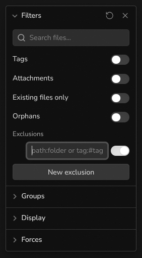

# Graph Exclusions

Hide notes from the graph view with reusable exclusion rules you can switch on and off.

Graph Exclusions adds an **Exclusions** section inside the **Filters** panel of both the global graph and the local graph. Each rule is a query with its own toggle, so you can hide a folder, a tag, or a group of files without rewriting your search filter every time.

## Usage

1. Open the graph view (global or local).
2. Open **Filters**. The **Exclusions** section appears below the existing filters.
3. Select **New exclusion** and type a query.
4. Use the toggle to turn the rule on or off. Hover a rule and select the **×** icon to remove it.

Rules are shared between the global graph and all local graphs. Links to and from excluded notes are hidden as well.

## Query syntax

| Query | Hides |
| --- | --- |
| `path:Archive` | Notes whose path contains `Archive` |
| `file:draft` | Notes whose file name contains `draft` |
| `tag:#journal` | Notes tagged `#journal` or any nested tag such as `#journal/2026`, and the `#journal` tag node |
| `meeting` | Notes whose path contains `meeting` |

Matching is case-insensitive. Values can be wrapped in quotes, for example `path:"My folder"`. A leading `-` is ignored, so `-path:Archive` works the same as `path:Archive`.

## Compatibility

The graph view has no public API for filtering nodes, so this plugin hooks into Obsidian's internal graph renderer. A future Obsidian update may break it. If the exclusions stop working, a warning is logged in the developer console. Please open an issue.

The plugin doesn't use the network and doesn't access files outside your vault.

## Installation

- **Community plugins:** search for "Graph Exclusions" in **Settings → Community plugins → Browse**.
- **Manual:** download `main.js`, `manifest.json`, and `styles.css` from the latest release into `<vault>/.obsidian/plugins/graph-exclusions/`, then enable the plugin in **Settings → Community plugins**.

## License

[MIT](./LICENSE)
